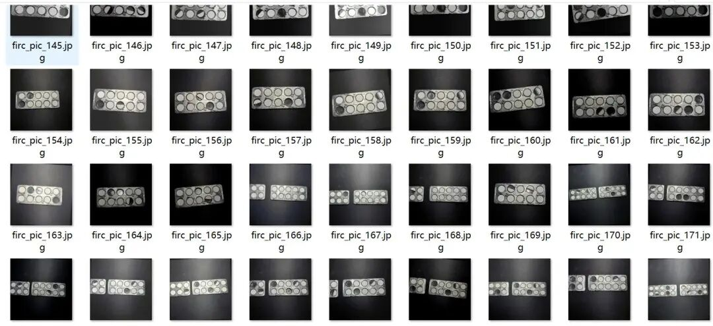
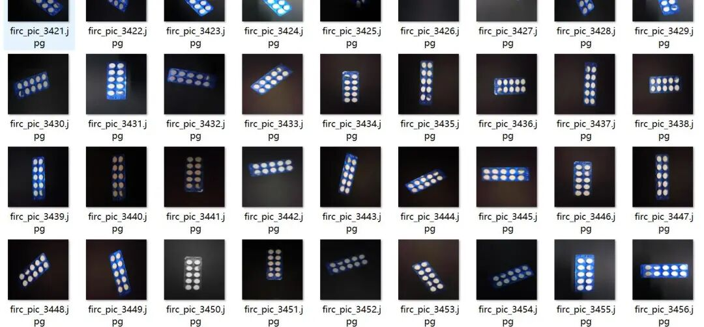
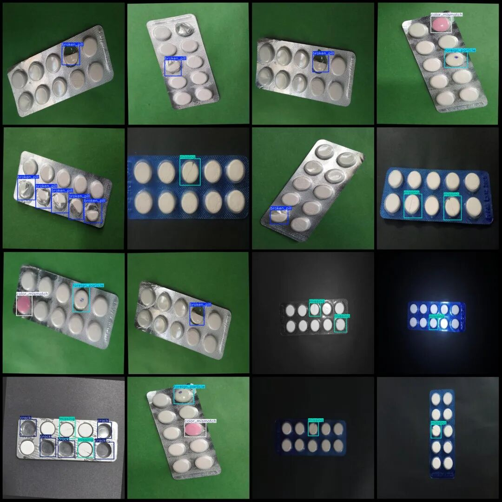
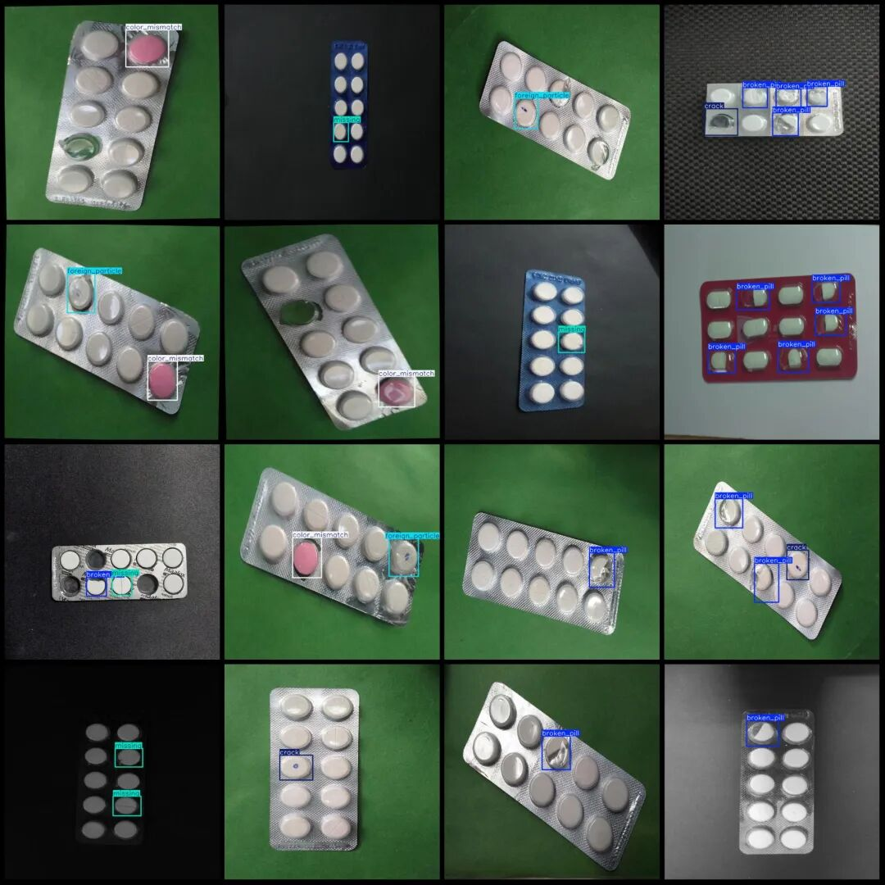

# Intelligent Medical Blister Tablet Drug Deficiency Detection Dataset VOC+YOLO Format 3685 Images 7 Categories

Dataset format: Pascal VOC format + YOLO format (txt file without split path, only contains jpg images and corresponding VOC format xml files and yolo format txt files)

Number of images (number of jpg files): 3685

Number of annotations (number of xml files): 3685

Number of annotations (number of txt files): 3685

Label category count: 7

Label category names (Note that the order of labels in YOLO format does not correspond to this, but is based on the "labels" folder's "classes.txt"): ["broken_pill", "color_mismatch", "crack", "foreign_particle", "missing", "seal_open", "seal_pinhole"]

Number of boxes labeled in each category:

Broken pill (pill damage) frame count = 2147

color_mismatch (Color Mismatch) Frames = 1060

Crack (cracks) = 634

foreign_particle ((Non-standard) Frame count = 961

Missing (missing) frames = 2081

seal_open (sealing open) frame count = 1

seal_pinhole (sealing pinhole) frame count = 2

Total frame count: 6886

Number of images per category:

broken_pill (drug pill) occupies 1128 images

color_mismatch (Color Mismatch) occupies 1059 images.

Crack (crack) occupies the number of pictures = 352

Foreign particle (foreign object) occupies the image count = 747

missing (missing) occupancy = 1237

seal_open (sealing open) occupies = 1

seal_pinhole (sealing pinhole) occupies = 2

Image resolution: 640x640

Using labelImg:

Annotation rules: Draw a rectangle around the category.

Important Notice: The dataset does not have separate training, validation, and test sets; you need to partition them yourself.

Special : This dataset does not guarantee the accuracy of the trained models or weight files.

Image Preview:

Annotation example:

## Payment

Here is a pay link on Stripe ( https://buy.stripe.com/3cs8yP7sY87d0vu9AB ). Please contact me lonlonago@foxmail.com after funding $89, and I will send you a complete data files , thank you!

